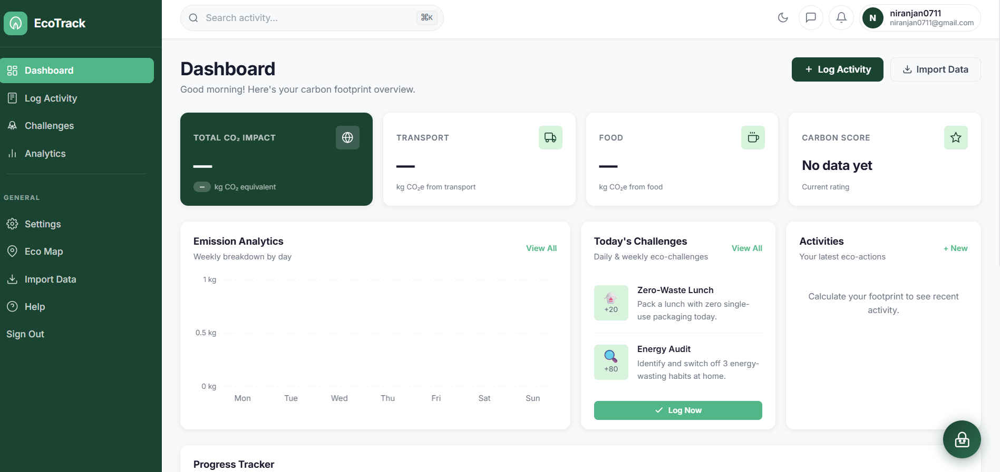

<div align="center">

# 🌿 Smart-EcoTrack

### Carbon Footprint Awareness Platform

**Track your impact · Reduce your emissions · Build sustainable habits**




</div>

---

## 📋 Table of Contents

- [About the Project](#-about-the-project)
- [Features](#-features)
- [Technology Stack](#-technology-stack)
- [Project Structure](#-project-structure)
- [Getting Started](#-getting-started)
- [Environment Configuration](#-environment-configuration)
- [Running the Application](#-running-the-application)

---

## 🌍 About the Project

**Smart-EcoTrack** is a web-based carbon footprint awareness platform that helps users understand the environmental impact of their everyday activities and develop more sustainable habits.

The application combines carbon emission calculations, interactive dashboards, AI-assisted recommendations, geographical visualisation, and eco-friendly challenges in one platform.

Users can:

- 📊 **Calculate** their carbon footprint across transportation, food, energy, and shopping.
- 📈 **Monitor** emission trends and monthly sustainability goals.
- 🤖 **Interact** with EcoBot, an AI-powered assistant that provides sustainability guidance.
- 🗺️ **Explore** emission-related geographical information and discover eco-friendly locations.
- 🏆 **Complete** daily and weekly eco-challenges to encourage sustainable habits.

---

## 🚀 Features

### 📊 Carbon Footprint Calculator

- Estimates emissions from everyday activities.
- Covers transportation, food, energy, and shopping.
- Displays results to help users understand their environmental impact.

### 📈 Interactive Dashboard

- Presents carbon footprint summaries and activity trends.
- Visualises data using Chart.js.
- Tracks progress towards monthly carbon reduction goals.

### 🤖 EcoBot AI Assistant

- Provides sustainability guidance through an interactive chat interface.
- Uses AI services to generate responses and recommendations.
- Supports fallback responses when configured AI services are unavailable.

### 🗺️ Interactive Eco Map

- Uses Leaflet.js and OpenStreetMap data for geographical visualisation.
- Displays transport routes and emission-related information.
- Helps users locate eco-friendly places, such as recycling centres and EV charging stations, where supported by available map data.

### 🏆 Eco-Challenges

- Offers daily and weekly sustainability challenges.
- Encourages environmentally responsible habits.
- Makes sustainability tracking more engaging through gamification.

### ⚙️ User Settings and Data Management

- Supports user authentication through Firebase Authentication.
- Uses Firebase Firestore for supported data storage.
- Provides profile and preference management.
- Supports importing activity records through CSV files.

### 🌙 Additional Features

- Light and dark themes.
- In-app notifications.
- Help centre and frequently asked questions.
- Progressive Web App (PWA) support.

---

## 🛠️ Technology Stack

### Backend

| Technology         | Purpose                                     |
| ------------------ | ------------------------------------------- |
| Python             | Backend programming language                |
| Flask              | Web application framework and API endpoints |
| Gunicorn           | Production WSGI server                      |
| Firebase Admin SDK | Server-side Firebase operations             |
| Groq API           | AI-powered EcoBot responses                 |
| Gemini API         | AI-generated sustainability tips            |
| Flask-Limiter      | API rate limiting                           |
| Flask-CORS         | Cross-origin request handling               |
| Pytest             | Automated testing                           |

### Frontend

| Technology        | Purpose                                    |
| ----------------- | ------------------------------------------ |
| HTML5             | Application structure                      |
| CSS3              | Styling and responsive layouts             |
| JavaScript (ES6+) | Client-side application logic              |
| Chart.js          | Data visualisation                         |
| Leaflet.js        | Interactive maps                           |
| Firebase Web SDK  | Client-side authentication and data access |
| Service Workers   | Progressive Web App functionality          |

### Database and Infrastructure

| Technology              | Purpose                               |
| ----------------------- | ------------------------------------- |
| Firebase Authentication | User authentication                   |
| Firebase Firestore      | NoSQL data storage                    |
| Vercel                  | Deployment configuration              |
| Render                  | Alternative deployment configuration  |
| OpenStreetMap           | Map data and geographical information |

---

## 📁 Project Structure

```text
Smart-EcoTrack/
├── api/
│   ├── __init__.py
│   ├── calculator.py
│   ├── challenges.py
│   ├── ecobot.py
│   ├── routes.py
│   └── tips.py
├── docs/
│   ├── screenshot-dashboard.png
│   └── screenshot-login.png
├── static/
│   ├── css/
│   │   ├── dark-mode.css
│   │   ├── ecobot.css
│   │   ├── map.css
│   │   └── styles.css
│   ├── js/
│   │   ├── app.js
│   │   ├── auth.js
│   │   ├── calculator.js
│   │   ├── challenges.js
│   │   ├── charts.js
│   │   ├── dashboard-ui.js
│   │   ├── dashboard.js
│   │   ├── ecobot.js
│   │   ├── firebase-config.js
│   │   ├── firestore.js
│   │   ├── help.js
│   │   ├── import.js
│   │   ├── insights.js
│   │   ├── map.js
│   │   ├── notifications.js
│   │   └── settings.js
│   ├── manifest.json
│   └── service-worker.js
├── templates/
│   └── index.html
├── tests/
│   ├── __init__.py
│   ├── conftest.py
│   ├── test_api.py
│   ├── test_calculator.py
│   ├── test_routes_firestore.py
│   └── test_validation.py
├── .env.example
├── .gitignore
├── .firebaserc
├── app.py
├── config.py
├── firebase.json
├── Procfile
├── pyproject.toml
├── render.yaml
├── requirements.txt
├── runtime.txt
└── vercel.json
```

---

## 🚀 Getting Started

### Prerequisites

Before running Smart-EcoTrack, ensure you have:

- Python 3.10 or later, subject to dependency compatibility.
- Git installed on your system.
- A Firebase project.
- Firebase Authentication with Email/Password enabled.
- A Firestore database.
- A Groq API key for EcoBot.
- A Gemini API key for sustainability tips.

Some features may require additional configuration.

### 1. Clone the Repository

```bash
git clone https://github.com/niranjanr7/Smart-EcoTrack.git
cd Smart-EcoTrack
```

### 2. Create a Virtual Environment

**Windows — PowerShell**

```powershell
python -m venv .venv
.\.venv\Scripts\Activate.ps1
```

**Linux or macOS**

```bash
python3 -m venv .venv
source .venv/bin/activate
```

### 3. Install Dependencies

```bash
python -m pip install --upgrade pip
python -m pip install -r requirements.txt
```

### 4. Configure Environment Variables

Create a local `.env` file using the provided template.

**Windows — PowerShell**

```powershell
Copy-Item .env.example .env
```

**Linux or macOS**

```bash
cp .env.example .env
```

Open `.env` and enter the required configuration values.

### 5. Configure Firebase

In the Firebase Console:

1. Create or select your Firebase project.
2. Enable Email/Password authentication.
3. Create a Firestore database.
4. Configure the Firebase Web SDK settings required by the frontend.
5. Configure the Firebase Admin SDK credentials required by the backend.

If the application uses a service account JSON file, save it locally and configure the corresponding environment variable.

**Important:** Never commit `.env` or Firebase service account credentials to GitHub.

---

## ▶️ Running the Application

After installing the dependencies and configuring the required environment variables, start the Flask development server:

```bash
python -m flask --app app run --port 5001
```

Open your browser and visit:

**http://127.0.0.1:5001**

If the application does not start, check that:

- Your virtual environment is activated.
- The required dependencies are installed.
- The environment variables are configured correctly.
- Firebase credentials are available if required.
- Port `5001` is available.
